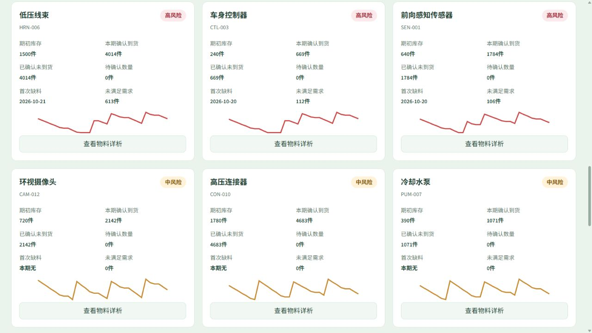
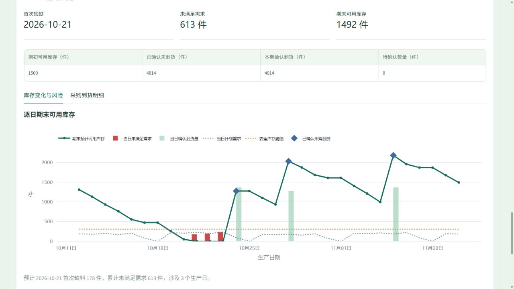
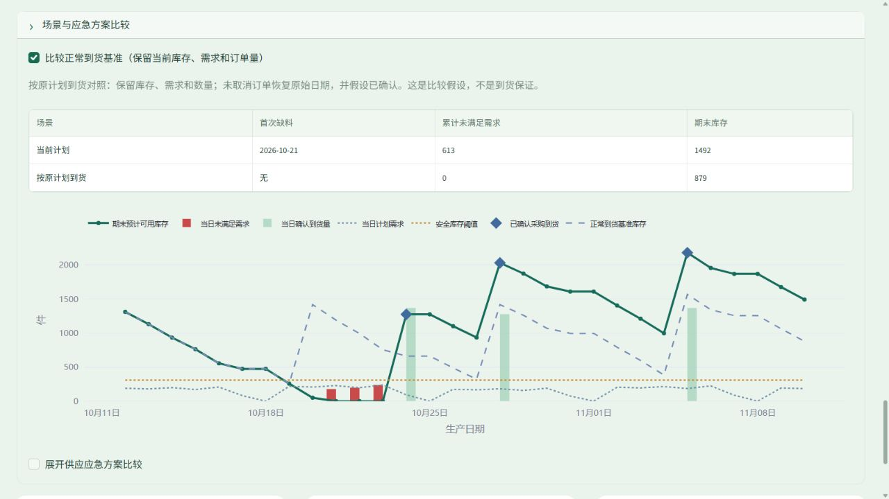
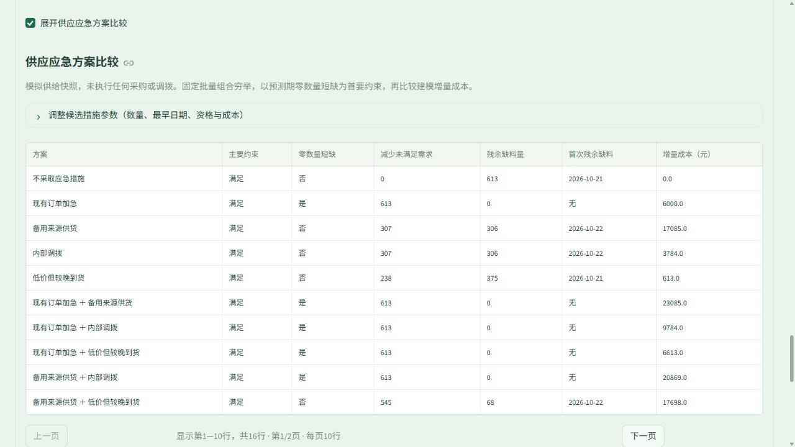
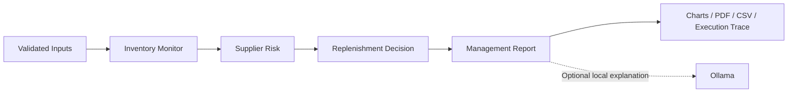

# AutoSupply Copilot

**Automotive Supply Risk & Material Planning Decision Support**

[Live Demo](https://autosupply-copilot.streamlit.app/) · [Source Code](https://github.com/youxing-han/AutoSupply-Copilot) · [User Guide](docs/LOCAL_USAGE.md)

Turn inventory, time-phased demand and purchase-order schedules into a practical view of material availability. Identify projected shortages, distinguish safety-stock warnings from unmet demand, and compare supply mitigation options under explicit timing, quantity and cost constraints.

A personal portfolio project developed with AI-assisted coding, using fictional automotive components. This is a scenario-based analysis tool, not an enterprise planning implementation or evidence of realized business savings.

> All components, suppliers, orders, production lines, demand, qualifications and costs are fictional. No ERP, carrier or enterprise database is connected. The application does not place orders, dispatch goods, transfer stock or contact suppliers. Use simulated or non-sensitive data only.

## Business Questions

- **Material availability:** Will stock cover demand before the next confirmed receipt?
- **Delivery exposure:** Which items become short when purchase orders arrive late or remain unconfirmed?
- **Planning priorities:** Is the issue a quantity shortage, a safety-stock warning or supplier status?
- **Response trade-offs:** Can expediting, backup supply or internal transfers close the gap within the modeled constraints, and at what incremental cost?

## Product Walkthrough

Captured from a fresh local run of `public_app.py` on **2026-10-23**, with model access disabled. These are real screenshots of the Chinese-language interface, not mockups. English documentation does not imply an English application UI. See [Screenshot Provenance](docs/SCREENSHOTS.md) for scenario details and reproduction steps.

### 1. Material Risk Dashboard

The 30-day supplier-delay scenario covers **12 SKUs**, with **3 projected shortage items** and **831 units of cumulative unmet demand** across items. Cards combine risk classification, opening stock, confirmed supply, first shortage date and inventory trends. Aggregated component units do not represent lost vehicle output.

[](docs/screenshots/demo-risk-dashboard.jpg)

### 2. Time-Phased Inventory Projection

For **HRN-006**, the delayed plan produces **613 unmet units** despite **1,492 units of closing stock**. Daily demand, confirmed receipts, safety stock and shortage bars explain the timing mismatch: later receipts cannot satisfy demand already missed under the no-backorder assumption.

[](docs/screenshots/demo-inventory-projection.jpg)

### 3. Delivery Scenario Comparison

Hold inventory, demand and quantities constant, then compare delayed delivery with an original-date receipt assumption. For the selected item, the reference has **zero unmet demand** and **879 units of closing stock**; the delayed plan has **613 unmet units**. This is a conditional comparison, not a delivery guarantee.

[](docs/screenshots/demo-delivery-scenario.jpg)

### 4. Supply Mitigation Trade-offs

Compare fixed-lot actions and combinations by eligibility, availability dates, remaining shortages and modeled incremental cost. Advancing an existing order removes the modeled shortage for **CNY 6,000** in this scenario; a cheaper late-arriving option still leaves **375 units unmet**. These are fictional outputs, not market quotations or realized savings.

[](docs/screenshots/demo-mitigation-tradeoffs.jpg)

## Capabilities

| Area | Implemented behavior |
|---|---|
| Single-SKU analysis | Stock coverage, lead-time coverage gap, reorder point, rule-based risk and reference replenishment quantity |
| Portfolio screening | Excel/CSV templates, validated imports, up to 50 SKUs, risk prioritization, drill-down and CSV export |
| Time-phased planning | 1-90 day horizon, daily demand, calendar-week editing, inventory curves, first shortage and unmet demand |
| Purchase-order analysis | Separate confirmed, pending and cancelled orders; only confirmed receipts enter projected supply |
| Mitigation assessment | Existing-order expediting, qualified backup supply, internal transfers and fixed-lot combinations; up to eight candidate actions per SKU |
| Visual analysis | Inventory, demand and receipt curves, safety-stock thresholds, shortage bars, priorities and scenario overlays |
| Reports and traceability | Template summaries, Chinese PDF reports, CSV results and the actual four-node execution trace |
| Optional local AI | Ollama `llama3.2` explains current facts; model failure does not invalidate business calculations |

The default planning dataset has 12 fictional components. Scenarios cover stable production, supplier delay, demand peaks, pending orders, weekend maintenance and clustered receipts. Tables paginate at ten rows without reducing the records included in analysis.

## Public Demo and Local AI

| Capability | Public demo | Local installation |
|---|---|---|
| Risk analysis, planning and mitigation | Available | Available |
| Excel/CSV inputs and PDF/CSV outputs | Available | Available |
| Computed facts and template explanations | Available, labeled as such | Available |
| Ollama Q&A and model commentary | Disabled; the page explains local Ollama is unavailable | Available when Ollama is running |

The hosted app runs independently of the developer's computer. `public_app.py` blocks model construction and calls on the server. No paid API or secret is required. Inputs, drafts, results and conversation state belong to the Streamlit session; uploads are not saved to disk or the repository. Download outputs before ending a session.

## Analysis Workflow



LangGraph coordinates a fixed four-node workflow. Deterministic Python rules calculate projections, risk categories, reference replenishment and mitigation comparisons. The model explains results; it does not calculate authoritative business values, execute purchasing or search the supplier market.

Dynamic planning applies **confirmed receipts, then daily demand**, with non-negative closing stock and unmet demand recorded separately. Pending and cancelled orders do not offset shortages. Mitigation checks supplied fixed-lot candidates and ranks executable scenarios by residual unmet demand, then incremental cost. It is not a global sourcing optimizer.

Local Q&A receives the current structured snapshot and limited conversation context. Computed facts and model commentary are displayed separately. Numeric and action-claim checks constrain free-form output; dynamic explanations use constrained selection of verified statements. These controls do not guarantee every explanation is correct.

## Try the Demo

1. Run a single-SKU scenario and compare stock coverage with procurement lead time.
2. Download a batch template, edit fictional values, upload it and run screening.
3. In dynamic planning, select the 12-component supplier-delay scenario, load the data and run analysis.
4. Inspect a high-risk component, its purchase orders and the original-date receipt reference.
5. Open mitigation comparison, review feasibility, remaining shortages and costs, then export CSV or PDF.

The UI is in Chinese. After editing inputs, run analysis again. The previous successful snapshot remains with an outdated-result warning; switching data sources hides results from the previous source.

## Local Setup

Use **Python 3.11**; the original clean environment used 3.11.9. Run from the repository root.

```bash
git clone https://github.com/youxing-han/AutoSupply-Copilot.git
cd AutoSupply-Copilot
python -m venv .venv
```

Windows PowerShell:

```powershell
.\.venv\Scripts\python.exe -m pip install -r requirements.lock.txt
.\.venv\Scripts\python.exe -m streamlit run app.py
```

Linux / macOS:

```bash
.venv/bin/python -m pip install -r requirements.lock.txt
.venv/bin/python -m streamlit run app.py
```

Core analysis requires no LLM. For optional local AI, install [Ollama](https://ollama.com/), run `ollama pull llama3.2` and start the service. The application uses `127.0.0.1:11434` for explicitly requested local model features. Downloads require network access and disk space.

For public-mode behavior, replace `app.py` with `public_app.py`. Use separate processes for the two modes. Desktop shortcuts are optional. See the [User Guide](docs/LOCAL_USAGE.md) and [Deployment Guide](docs/DEPLOYMENT.md).

## Verification and Data Handling

```powershell
.\.venv\Scripts\python.exe -m unittest discover -s tests -v
```

On Linux/macOS, use `.venv/bin/python`; Windows launcher tests are skipped. The [Release Audit](docs/RELEASE_AUDIT.md) distinguishes dated local, cloud and real-model evidence from unverified areas. Screenshots are not proof of all functionality.

Checks include hand-calculated coverage and replenishment, inventory conservation, delayed/unconfirmed orders, fixed-lot costs, candidate constraints, model failure and session isolation. In a separate five-component fixture, opening stock 800, daily demand 80 and a receipt of 500 on day eight leave 180 units after 14 days with no shortage. Moving the receipt to day twelve creates 80 unmet units. This fixture differs from the screenshot scenario.

Uploads are parsed in memory and never executed. Limits: 5 MB per upload, 25 MB XLSX decompression, 200 archive entries, 50 batch SKUs, 4,500 dynamic demand rows and 500 orders. Validation rejects macros, external workbook links, invalid dates, non-finite/negative values, duplicate identifiers and broken references. Do not use sensitive business data. Concurrency stress testing and professional penetration testing have not been performed.

## Stack and Project Context

Streamlit handles the interface and sessions; LangGraph coordinates analysis; pandas processes tables; Plotly renders charts; openpyxl supports Excel; ReportLab generates PDF; optional Ollama integration supports local explanations.

This personal project extends an open-source example through AI-assisted development (Vibe Coding). The portfolio emphasizes scenario definition, assumptions, result verification and demonstrable functionality, without claiming independent mastery of every underlying technology. Attribution remains in `THIRD_PARTY_NOTICES.md`; the original copyright and license remain in `LICENSE`.

## Model Boundaries

- Static coverage assumes constant average demand and excludes purchase orders and a full demand calendar.
- Dynamic planning accepts component demand directly; there is no vehicle-plan/BOM explosion or complete ERP/MRP process.
- Unmet demand does not roll forward as backorders; projected shortages are not proof of production stoppages.
- Safety stock is a policy input, not a statistical estimate of demand or lead-time uncertainty.
- Mitigation is per SKU and fixed lot; it excludes cross-SKU capacity optimization, taxes, line-stop losses and continuous order-quantity optimization.
- Results depend on fictional inputs and simplified rules. No enterprise validation, forecast improvement or realized savings are claimed.
- Model explanations can fail or mislead. Computed values and documented assumptions remain the reference.
