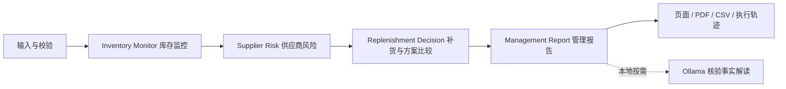
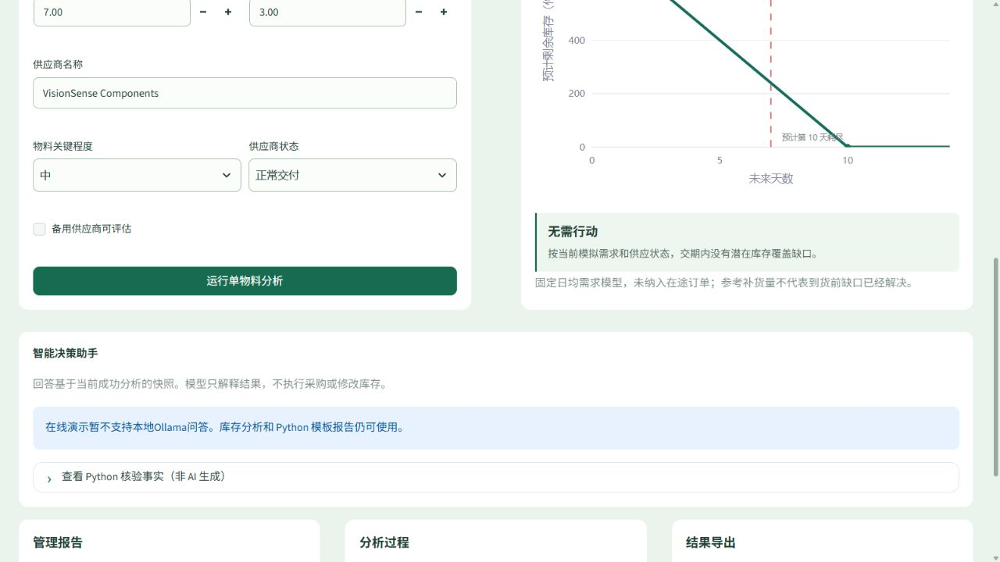
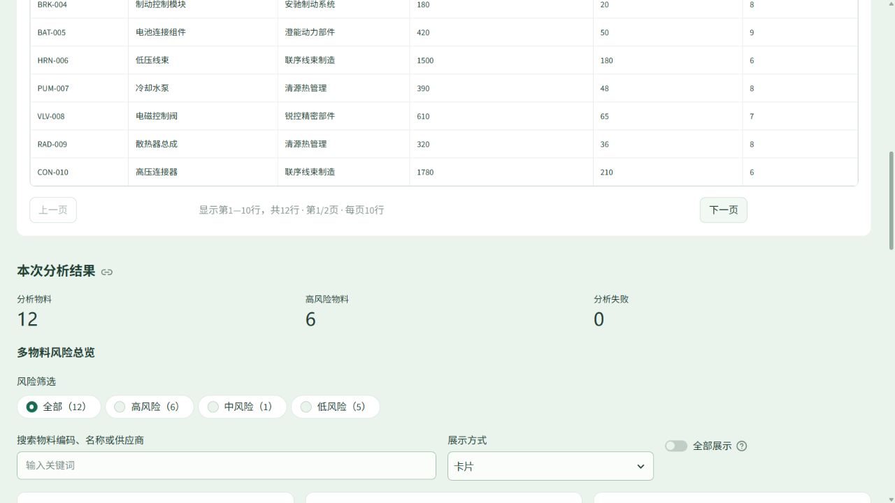
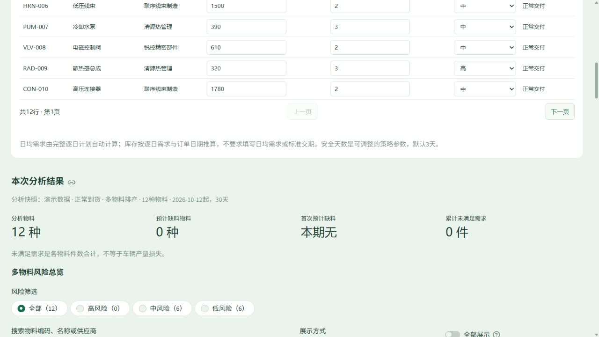

# AutoSupply Copilot

**汽车零部件供应风险与动态物料计划决策支持演示系统**

面向库存监控、供应商延期和生产需求变化等场景，将零部件库存、需求计划和采购到货计划转换为可核验的风险指标、库存曲线与应急方案对照。适合供应链岗位项目展示及业务模型学习。

> 内置零部件、供应商、订单、产线、成本和需求记录均为完全虚构的模拟数据。系统未接入 ERP/SAP、承运商或企业数据库，不会执行采购、发运、调拨或供应商操作。公开演示请仅使用模拟或非敏感数据。

AutoSupply Copilot is an automotive supply-risk and material-planning demo built with Streamlit and LangGraph. Deterministic Python rules calculate business results; an optional local Ollama model explains verified facts.

## 项目解决的问题

- 库存数量看似充足，但不能覆盖供应商交期或近期排产需求。
- 采购订单总量足够，但到货日期晚于缺料日期；待确认订单不能直接计作可靠供应。
- 多物料表格中风险难以排序，单个物料的缺料时间与原因不易追踪。
- 加急、备用供应和调拨方案存在不同成本、资格和数量约束，需要在相同需求计划下比较。

这些是真实业务中的问题类型；本项目用于演示简化模型，不提供经过企业实证验证的预测准确率或收益提升承诺。

## 核心功能

| 功能 | 当前实现 |
|---|---|
| 单零部件情景分析 | 库存覆盖、交期缺口、再订货点、风险规则和参考补货量；支持正常供应、延期与关键短缺 |
| Excel / CSV 批量分析 | 模板下载、导入校验、最多 50 个 SKU、风险排序、单项详析与 CSV 导出 |
| 动态物料计划 | 1–90 天逐日需求、自然周编辑、库存曲线、首次缺料日期和累计未满足需求 |
| 采购订单分析 | 区分已确认、待确认和已取消订单；按日期计入确认到货，展示订单对缺料的影响 |
| 应急方案比较 | 单 SKU 的加急、合格备用供应、库存调拨及固定批量组合；比较残余缺料与增量费用 |
| 报告和追踪 | Python 模板管理报告、中文 PDF、CSV 和实际四节点执行轨迹 |
| 本地 AI 解读 | Ollama `llama3.2` 基于当前分析快照回答问题；校验失败或服务不可用时保留业务结果 |

默认演示包含 12 种虚构零部件，可选择平稳排产、供应商延期、排产高峰、订单待确认、周末检修和集中到货等情景。输入预览与结果表每页最多 10 行，分页不减少实际参与计算的记录。

## 在线演示与本地模式

在线部署入口为 `public_app.py`。部署状态和经验证的访问地址见 [部署说明](docs/DEPLOYMENT.md)；尚未验证的地址不作为项目链接。

| 能力 | 公开演示模式 | 本地模式 |
|---|---|---|
| 库存、风险、动态计划、应急方案 | 可用 | 可用 |
| 模拟 Excel 下载/导入、PDF、CSV | 可用 | 可用 |
| Python 模板报告与核验事实 | 可用，明确标注来源 | 可用 |
| Ollama 问答与模型报告补充 | 禁用，提示“在线演示暂不支持本地Ollama问答” | 安装并启动本地模型后可用 |

公开入口在服务端禁止创建模型客户端，不访问开发者个人电脑或本地 Ollama，不需要付费 API。业务结果和上传内容保存在各自的 Streamlit 会话中，不写入磁盘或公开仓库；刷新、关闭会话或服务重启可能丢失草稿，请及时下载所需结果。

## 建议体验流程

1. **单物料分析**：切换正常供应与延期情景，运行分析，比较库存覆盖与交期缺口。
2. **多物料批量分析**：直接运行内置 12 物料示例；下载模拟 Excel，在本机修改后从“文件导入”上传并重新运行。
3. **动态物料计划**：加载供应商延期或排产高峰情景，运行分析，选择物料查看逐日库存、确认到货和缺料日期。
4. **应急方案**：在单物料详析中展开“场景与应急方案比较”，比较基准、单方案和组合方案。
5. **结果核验**：查看管理报告、四节点轨迹，并下载 PDF 或 CSV。输入改变后需重新运行，旧快照会显示过期提示；切换数据来源会隐藏旧来源结果。

可复核示例：使用“公式核验数据包”，传感器期初 800 件、每天需求 80 件，第 8 天收到 500 件，14 天期末为 180 件、未满足需求为 0；将到货改到第 12 天，累计未满足需求为 80 件。该数据包与默认 12 物料排产示例不同。

## LangGraph 工作流



这是固定四节点的编排流程。库存推演、风险分级、补货参考量和方案比较由 Python 完成；LangGraph 管理状态传递和执行顺序。模型不自主计算业务数值，不执行采购，也不进行全市场供应商搜索。

动态库存按“当天确认到货 → 当天需求 → 期末可用库存”计算，库存下限为零，未满足需求单独记录。只有已确认订单进入到货量；待确认与取消订单不抵减缺料风险。成本比较仅针对已输入的固定批量候选，最多 8 条。

## 本地安装与运行

使用 Python **3.11**，建议与验证环境的 3.11.9 保持一致。依赖版本记录在 `requirements.txt`；Windows 启动脚本不是云端运行前提。

```bash
git clone https://github.com/youxing-han/AutoSupply-Copilot.git
cd AutoSupply-Copilot
python -m venv .venv
```

Windows PowerShell：

```powershell
.\.venv\Scripts\python.exe -m pip install -r requirements.txt
.\.venv\Scripts\python.exe -m streamlit run app.py
```

Linux / macOS：

```bash
.venv/bin/python -m pip install -r requirements.txt
.venv/bin/python -m streamlit run app.py
```

无需模型即可运行核心分析。需要本地 AI 时，另行安装 [Ollama](https://ollama.com/)，运行 `ollama pull llama3.2` 下载模型并启动 Ollama 服务；模型下载会使用网络和磁盘。应用只连接本机 `127.0.0.1:11434`，主动提问或请求报告补充时才调用。

本地预览公开模式：将上述启动命令的 `app.py` 换成 `public_app.py`。也可通过 `AUTOSUPPLY_MODE=public` 配置 `app.py`；未设置时默认为本地模式。两个模式应使用独立服务进程。

Windows 桌面快捷方式可由 `scripts/create_desktop_shortcuts.ps1` 创建。完整操作说明见 [本地使用指南](docs/LOCAL_USAGE.md)。

## 真实页面截图

以下是项目实际运行页面，不是效果图。截图来源和验证范围见 [发布检查记录](docs/RELEASE_AUDIT.md)。







## 技术与开发方式

Streamlit 页面与会话状态、LangGraph 四节点编排、pandas 数据处理、Plotly 图表、openpyxl Excel 读写、ReportLab PDF 生成，以及可选的 LangChain Ollama 客户端。

项目基于原有开源示例二次开发，主要通过 AI 辅助开发（Vibe Coding）完成迭代。展示重点是业务问题定义、输入与约束、公式核验、场景比较和功能验收；不将 AI 辅助生成代码等同于开发者已独立掌握全部底层工程能力。

## 验证与数据安全

```powershell
.\.venv\Scripts\python.exe -m unittest discover -s tests -v
```

Linux / macOS 使用 `.venv/bin/python` 执行同一命令，Windows 启动脚本测试会跳过。验证记录见 [发布检查记录](docs/RELEASE_AUDIT.md)。

文件在内存中解析，不执行上传文件中的代码。服务器限制文件体积 5 MB、XLSX 总解压体积 25 MB、内部文件数量和表格规模；拒绝宏和外部链接工作簿。批量最多 50 SKU；动态需求最多 4500 行、订单最多 500 行。解析后校验必填字段、非负有限数值、日期、重复标识、供应商资格与关联关系。

公开服务不是敏感数据处理平台，也未做高并发压力测试；即使数据不持久化，也请不要上传个人信息或企业资料。

## 业务模型限制

- 单物料与批量静态分析使用固定日均需求，不含完整采购订单和需求日历；按日期分析需使用动态模式。
- 动态模式直接输入物料需求，没有车型计划 × BOM 展开，不是完整 ERP/MRP。
- 未满足需求不自动结转为欠交；没有收货时刻、物流跟踪或真实到货保证。
- 安全库存为演示策略参数，没有统计估计需求与交期不确定性。
- 应急方案按单 SKU、固定数量穷举；不含跨 SKU 共用产能优化、税费、停线损失或连续订货量求解。
- 风险与推荐依赖输入质量和简化规则，没有经过真实企业数据实证评估。
- 本地小模型的解释可能失败，校验只能约束部分错误，业务数值始终以 Python 结果为准。

## 开源来源与许可

本项目基于 [Cindy Aprilia / SupplyChainAgenticAI](https://github.com/cinapr/SupplyChainAgenticAI) 二次开发。本地保留原始食品供应链实验作为来源参考；公开演示快照仅包含当前汽车零部件应用所需文件，不包含上游视频和旧实验结果。来源信息见 [THIRD_PARTY_NOTICES.md](THIRD_PARTY_NOTICES.md)。

遵循 [MIT License](LICENSE)，保留原作者版权声明。第三方 Python 依赖遵循各自许可证。公开发布不代表对上传资料或第三方素材取得额外使用权。
